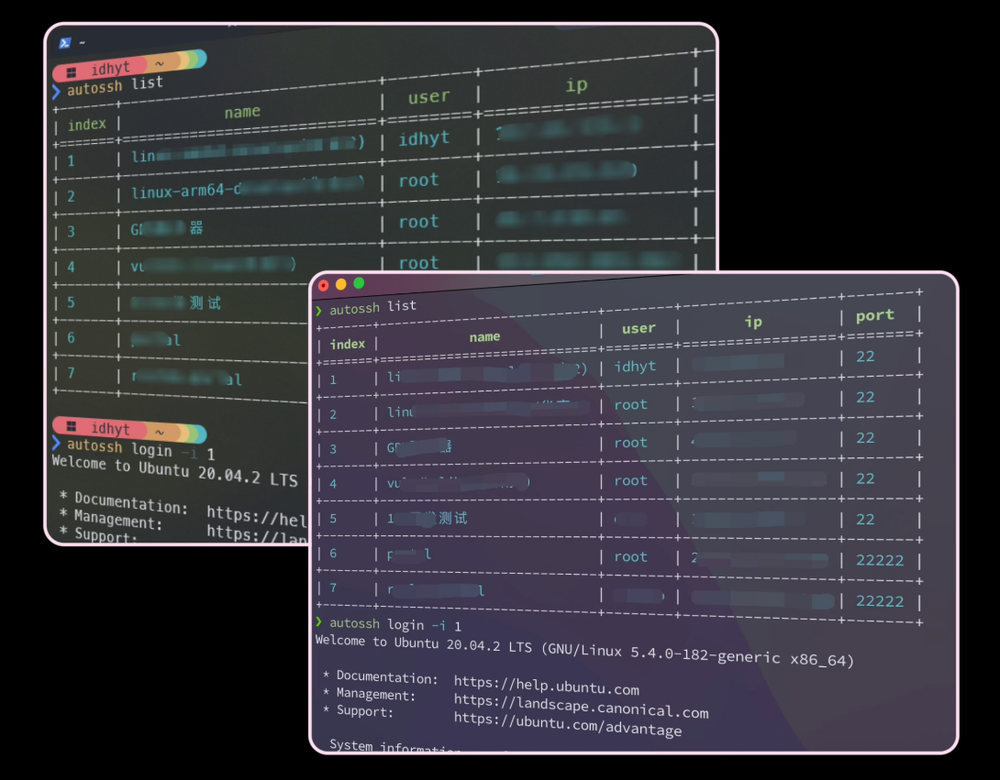

# Usage

数据迁移时候整个目录拷贝即可

```bash
╰─ tree ~/.config/atsh.d
~/.config/atsh.d
├── config.toml                      # remotes and SSH key paths
├── id_rsa                           # SSH private key
├── id_rsa.pub                       # SSH public key
└── logs                             # log directory
    └── 2025-07-21.json
```

免密登录、数据迁移、本地构建等参考文档 [README.md](https://github.com/idhyt/autossh/blob/main/README.md)
